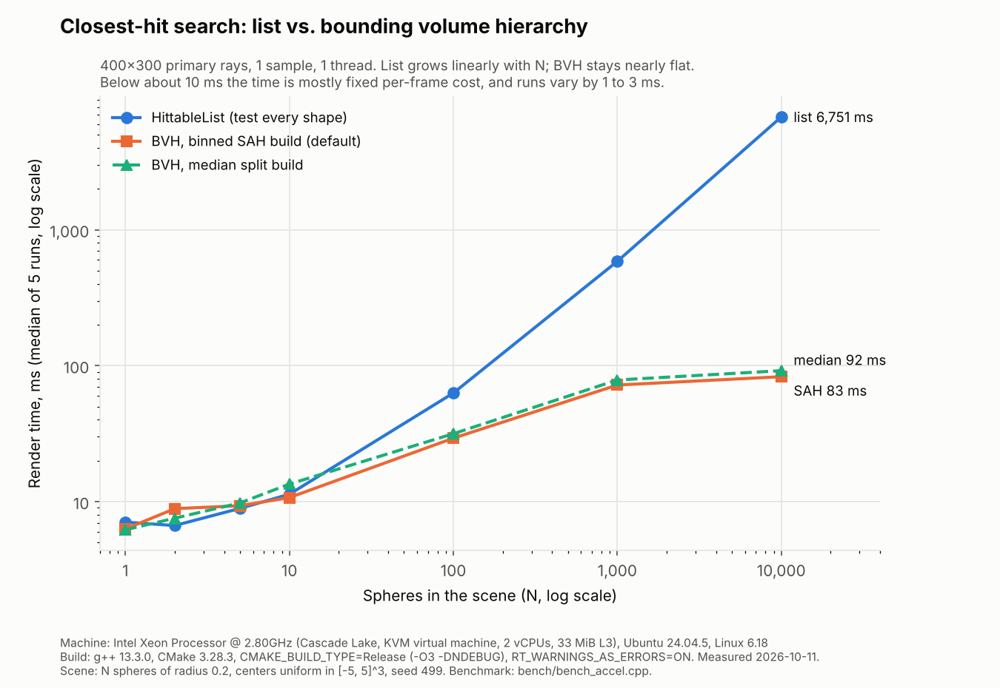

# CS 499 Capstone: Ray Traced Scene

Enhancement of my CS 330 (Computational Graphics and Visualization) artifact.
The original rendered a desk scene with OpenGL rasterization. This version
renders the same scene with a CPU ray tracer written in modern C++17.


## Status

| Enhancement | Category | Status |
|---|---|---|
| One | Software design and engineering | Complete (Milestone Two) |
| Two | Algorithms and data structures (bounding volume hierarchy) | Complete (Milestone Three) |
| Three | Databases (CS 340 artifact, separate repository) | Planned |

## Repository layout

```
original/            CS 330 module 3 export. The fixed "before" baseline.
src/core/            Vec3, Ray, AABB, Hittable interface, RNG, constants
src/accel/           Bounding volume hierarchy (Enhancement Two), test counters
src/geometry/        Sphere, Box, Plane, Cylinder, Cone, HittableList
src/materials/       Material interface: Lambertian, Metal, Dielectric
src/render/          Camera, Renderer, Image (BMP and PPM output)
src/scene/           The original desk scene as named constants
src/app/             Command-line parsing and main()
tests/               75 unit tests plus CTest end-to-end tests
bench/               List vs. BVH benchmark and its chart script
docs/renders/        Output images
docs/bench/          Benchmark results (CSV) and chart
.github/workflows/   CI: build and test on Windows and Linux
SPEC.md              Enhancement plan
CODE_REVIEW_SCRIPT.md  Code review of the original
```

## Build and run

Needs only CMake 3.16+ and a C++17 compiler. No graphics libraries.

```
cmake -S . -B build
cmake --build build --config Release
ctest --test-dir build -C Release --output-on-failure
```

Render (on Windows the program is in `build\Release\`):

```
raytracer --scene desk --out desk.bmp
raytracer --scene showcase --camera closeup --samples 200 --out showcase.bmp
raytracer --scene desk --accel list --out desk_list.bmp
raytracer --help
```

`--accel bvh` (the default) searches the scene with the bounding volume
hierarchy. `--accel list` tests every shape, the Enhancement One way. Both
write the same image, byte for byte.

### Tests

`ctest` runs the unit tests and the end-to-end tests. The end-to-end tests
render the showcase scene with `--accel list` and with `--accel bvh` and
fail if the two files differ by a single byte. To see each unit test by
name, run the test program directly:

```
build/raytracer_tests          (Windows: build\Release\raytracer_tests.exe)
```

### Benchmark

The benchmark is built with everything else but never runs in CI. Run it on
a Release build. It takes about a minute. On Windows the programs are in
`build\Release\`.

```
build/raytracer_bench --out bvh_timing.csv
build/raytracer_bench_stats --runs 1 --out bvh_counts.csv
python3 bench/plot_bvh.py --timing bvh_timing.csv --counts bvh_counts.csv \
    --machine docs/bench/machine.txt --out-dir docs/bench
```

`raytracer_bench` measures time. `raytracer_bench_stats` is the same program
built with per-ray counters (box tests and shape tests). Counting slows
every test down, so its times are ignored and only its counts are used.
The script needs Python 3 and matplotlib. It writes `docs/bench/bvh_results.csv`
and `docs/bench/bvh_chart.png`.

## What changed and why

### Enhancement One: rasterizer to ray tracer

| Original (CS 330) | Enhanced | Code review finding addressed |
|---|---|---|
| Immediate-mode draw calls per shape | `Hittable` interface with five analytic shapes | `RenderScene` too complex, knew every shape |
| Material uniforms set by string name, never called | `Material` interface: Lambertian, Metal, Dielectric | Dead material subsystem, magic strings |
| Raw `new` and `delete`, global pointers | `std::unique_ptr` scene ownership, shared materials | Leaks, rule of three, double free risk |
| Scene values as unnamed literals | Named `constexpr` constants, leg positions derived | Magic numbers, fragile leg and desk relationship |
| Fixed 16-slot texture array, no bounds check | `std::vector` storage, every pixel index checked | Unchecked index |
| Errors ignored or printed as success | Exceptions with clear messages, one catch in `main` | Missing `else`, false success message |
| Aspect ratio fixed to window size | Aspect ratio from output image size | Wrong after resize |
| Visual Studio solution only | Portable CMake, unit tests, GitHub Actions CI | No tests, one-IDE build |

### Design trade-off: analytic shapes vs. triangle meshes

The course `ShapeMeshes` class already builds triangle meshes, so testing rays
against triangles was the easy path. I solved each shape analytically instead.

- Exact curved surfaces. No faceting on the sphere, cylinder, or cone.
- One test per shape instead of hundreds of triangle tests.
- Cost: more math per shape, and the cone needs a special linear case.

### Numerical safety

- `kHitEpsilon` ignores hits near t = 0, which prevents self-shadowing noise.
- Rays parallel to a slab, plane, or axis are detected before any division.
- NaN samples are written as black instead of corrupting the image.
- Renders are deterministic: the same seed gives the same image on any thread count.

## Enhancement Two: bounding volume hierarchy

Enhancement One found the closest hit by testing every shape: O(n) per ray.
Enhancement Two adds a bounding volume hierarchy (BVH), a binary tree of
boxes. A ray only looks inside the boxes it passes through, so it does
about O(log n) work per ray.

| Before (Enhancement One) | After (Enhancement Two) | Why |
|---|---|---|
| `HittableList` tests all n shapes per ray | `Bvh` tests about log n boxes, then a few shapes | O(n) to O(log n) per ray |
| `Aabb` existed but nothing used it | Every node is an `Aabb`; new entry-distance test and surface area | Near child first, SAH cost model |
| No build step | Binned surface area heuristic build, 12 bins, median fallback | Fewer tests per ray than a plain median split |
| Scene owned by the list | `release_objects()` moves the shapes into the `Bvh` | Ownership moves, nothing copied, still `unique_ptr` |
| One search strategy | `--accel list\|bvh`, validated like every other option | The list stays as the trusted baseline |
| No performance evidence | Benchmark, CSV, and chart under `docs/bench/` | Measured, not claimed |



Render time for primary rays (400x300, 1 sample, 1 thread, median of 5
runs). Intel Xeon @ 2.80GHz (KVM, 2 vCPUs), g++ 13.3.0, Release build.
Full numbers: [`docs/bench/bvh_results.csv`](docs/bench/bvh_results.csv).

| Spheres | List render | BVH render | BVH build | Speedup | Box tests per ray | Shape tests per ray (list / BVH) |
|---:|---:|---:|---:|---:|---:|---:|
| 10 | 11.3 ms | 10.7 ms | 0.006 ms | 1.1x | 2.8 | 10 / 1.1 |
| 100 | 62.9 ms | 29.3 ms | 0.055 ms | 2.1x | 11.3 | 100 / 2.4 |
| 1,000 | 586 ms | 72.1 ms | 1.0 ms | 8.1x | 28.6 | 1,000 / 6.1 |
| 10,000 | 6,751 ms | 83.0 ms | 9.3 ms | 81x | 34.4 | 10,000 / 6.3 |

What the numbers say:

- The list grows linearly. Ten times the spheres costs about ten times the time.
- The BVH barely grows. From 1,000 to 10,000 spheres it goes from 72 ms to 83 ms.
- Below about 10 spheres the two are within run-to-run noise. The list was
  ahead at 2 and 5 spheres. On the 6-object desk scene a full render is
  about 15 to 25 percent slower with the BVH. Small scenes do not need it.
- The SAH build is 8 to 10 percent faster to render than a median split at
  1,000 and 10,000 spheres. It costs at most half a millisecond more to
  build, which is repaid within the first frame.

### Design trade-offs

- **Flat array, not pointer nodes.** All nodes live in one `std::vector`.
  One allocation, nodes close together in memory, nothing to delete by hand.
  The right child is always next to the left child, so a node stores only
  one child index.
- **Binned SAH, not the full sweep.** 12 bins test 11 split planes per node
  instead of every possible one. Build stays O(n log n) and the tree is
  nearly as good.
- **Iterative traversal with a fixed stack.** No recursion in the hot path.
  The build guarantees the tree fits the 64-entry stack: from depth 32 on it
  only uses median splits, which halve the shape count every level.
- **Exact same answer as the list.** The closest hit so far is passed into
  every box and shape test. A randomized test checks 10,000 rays against
  1,000 spheres, and the desk and showcase images are byte-identical.
- **Counters cost nothing when off.** The per-ray counters compile away
  unless `RT_ENABLE_TRAVERSAL_STATS` is set, and only the benchmark sets it.

## Provenance

`original/SceneManager.cpp` scene code is my CS 330 work. `ShapeMeshes.*` and
`Utilities/camera.h` were provided by the course and are not claimed as mine.
Everything under `src/`, `tests/`, and `bench/` is new for CS 499.
