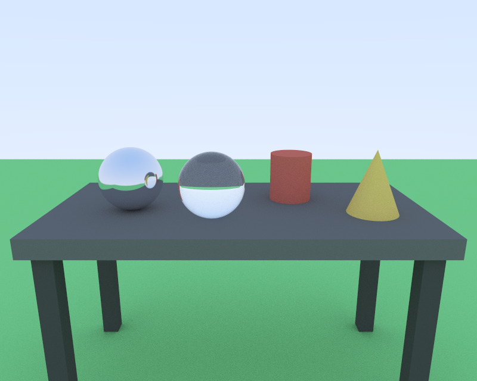

# CS 499 Capstone: Ray Traced Scene

Enhancement of my CS 330 (Computational Graphics and Visualization) artifact.
The original rendered a desk scene with OpenGL rasterization. This version
renders the same scene with a CPU ray tracer written in modern C++17.



## Status

| Enhancement | Category | Status |
|---|---|---|
| One | Software design and engineering | Complete (Milestone Two) |
| Two | Algorithms and data structures (bounding volume hierarchy) | Planned |
| Three | Databases (CS 340 artifact, separate repository) | Planned |

## Repository layout

```
original/            CS 330 module 3 export. The fixed "before" baseline.
src/core/            Vec3, Ray, AABB, Hittable interface, RNG, constants
src/geometry/        Sphere, Box, Plane, Cylinder, Cone, HittableList
src/materials/       Material interface: Lambertian, Metal, Dielectric
src/render/          Camera, Renderer, Image (BMP and PPM output)
src/scene/           The original desk scene as named constants
src/app/             Command-line parsing and main()
tests/               55 unit tests plus CTest smoke tests
docs/renders/        Output images
.github/workflows/   CI: build and test on Windows and Linux
SPEC.md              Enhancement plan
CODE_REVIEW_SCRIPT.md  Code review of the original
```

## Build and run

Needs only CMake 3.16+ and a C++17 compiler. No graphics libraries.

```
cmake -S . -B build
cmake --build build --config Release
ctest --test-dir build -C Release --output-on-failure
```

Render (on Windows the program is in `build\Release\`):

```
raytracer --scene desk --out desk.bmp
raytracer --scene showcase --camera closeup --samples 200 --out showcase.bmp
raytracer --help
```

## What changed and why

| Original (CS 330) | Enhanced | Code review finding addressed |
|---|---|---|
| Immediate-mode draw calls per shape | `Hittable` interface with five analytic shapes | `RenderScene` too complex, knew every shape |
| Material uniforms set by string name, never called | `Material` interface: Lambertian, Metal, Dielectric | Dead material subsystem, magic strings |
| Raw `new` and `delete`, global pointers | `std::unique_ptr` scene ownership, shared materials | Leaks, rule of three, double free risk |
| Scene values as unnamed literals | Named `constexpr` constants, leg positions derived | Magic numbers, fragile leg and desk relationship |
| Fixed 16-slot texture array, no bounds check | `std::vector` storage, every pixel index checked | Unchecked index |
| Errors ignored or printed as success | Exceptions with clear messages, one catch in `main` | Missing `else`, false success message |
| Aspect ratio fixed to window size | Aspect ratio from output image size | Wrong after resize |
| Visual Studio solution only | Portable CMake, unit tests, GitHub Actions CI | No tests, one-IDE build |

### Design trade-off: analytic shapes vs. triangle meshes

The course `ShapeMeshes` class already builds triangle meshes, so testing rays
against triangles was the easy path. I solved each shape analytically instead.

- Exact curved surfaces. No faceting on the sphere, cylinder, or cone.
- One test per shape instead of hundreds of triangle tests.
- Cost: more math per shape, and the cone needs a special linear case.

### Numerical safety

- `kHitEpsilon` ignores hits near t = 0, which prevents self-shadowing noise.
- Rays parallel to a slab, plane, or axis are detected before any division.
- NaN samples are written as black instead of corrupting the image.
- Renders are deterministic: the same seed gives the same image on any thread count.

## Provenance

`original/SceneManager.cpp` scene code is my CS 330 work. `ShapeMeshes.*` and
`Utilities/camera.h` were provided by the course and are not claimed as mine.
Everything under `src/` and `tests/` is new for CS 499.
